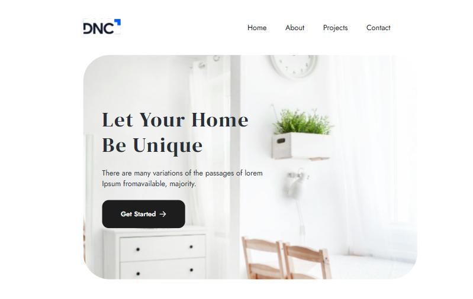

# 🏛️ Site de Arquitetura em React

Site institucional de um escritório de arquitetura, desenvolvido com **React** e **Vite** durante a formação em Engenharia de Software da Escola DNC.

🔗 **Ver online:** https://mgarajau.github.io/site-arquitetura-react/



## ✨ Funcionalidades

- **4 páginas** (Home, About, Projects e Contact) com navegação via **React Router**
- **Componentes reutilizáveis**: Header, Hero, Banner, Button, ContactForm, ProjectsList e Footer
- **Consumo de API REST** com `fetch` e `async/await` para listar os projetos dinamicamente
- Gerenciamento de estado com **useState** e **useEffect**
- **Menu mobile** responsivo com abrir/fechar
- Rolagem automática para o topo ao trocar de página

## 🛠️ Tecnologias


## 📁 Estrutura

```
src/
├── components/   # Componentes reutilizáveis (Header, Hero, Banner, ...)
├── pages/        # Home, About, Projects e Contact
├── services/     # Comunicação com a API
└── utils/        # ScrollToTop
```

## ▶️ Como rodar localmente

```bash
git clone https://github.com/mgarajau/site-arquitetura-react.git
cd site-arquitetura-react
npm install
npm run dev
```

## 👤 Autor

**Matheus Garajau** · [LinkedIn](https://www.linkedin.com/in/matheus-garajau/) · [GitHub](https://github.com/mgarajau)
